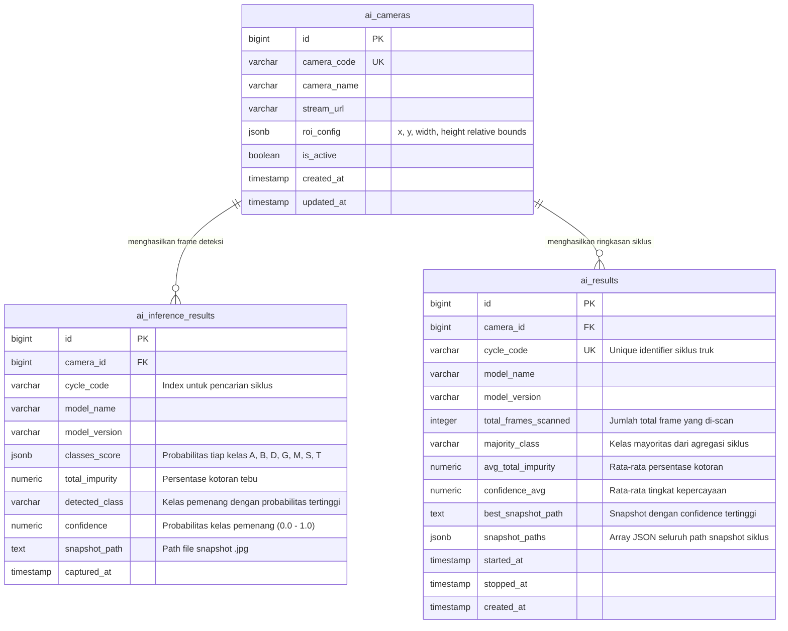

# 🤖 Dokumentasi Arsitektur & Operasional AI Service (`apps/ai-service`)
**Sugarcane Quality Grading Platform — MBS Project**

Dokumen ini berisi spesifikasi teknis mendalam mengenai **AI Service Engine** (`apps/ai-service`) dan **Database Mandiri** (`sugarcane_ai`). Dokumentasi ini mencakup skema database, relasi antar-tabel, definisi kolom, konsep arsitektur, flow eksekusi thread, hingga matematika inferensi model.

Pembaruan mode Auto (full frame 3 detik → grading 30 detik), konfigurasi, endpoint,
dan panduan pengoperasian tersedia di [AUTO_CYCLE.md](AUTO_CYCLE.md).

---

## 🏗️ 1. Konsep Dasar & Arsitektur Mandiri

### 🎯 Prinsip Decoupling & Otonomi Database
1. **Separation of Concerns:** `apps/ai-service` dirancang 100% independen dari aplikasi backend utama (`apps/api`). AI Service mengelola database PostgreSQL miliknya sendiri, yaitu **`sugarcane_ai`**.
2. **Koneksi CCTV Langsung:** AI Service membaca stream RTSP/HTTP secara independen dari perangkat CCTV tanpa bergantung pada server streaming pihak ketiga.
3. **Penyimpanan Snapshot Lokal & Statis:** Setiap citra hasil crop ROI disimpan ke disk lokal `storage/snapshots/` dan dapat diakses publik via HTTP endpoint static file FastAPI `/snapshots/{filename}`.
4. **State Machine Pemindaian:** AI Service mengelola status pemindaian (*Cycle*) menggunakan thread background async yang aman dari kebocoran memori (*thread-safe*).

---

## 🗄️ 2. Arsitektur Database Mandiri (`sugarcane_ai`)

### 📊 Entity Relationship Diagram (ERD)



---

### 📋 Spesifikasi Skema & Definisi Kolom Database

#### 1. Tabel `ai_cameras`
Menyimpan registrasi perangkat kamera CCTV beserta konfigurasi wilayah ukur (ROI).

| Nama Kolom | Tipe Data | Constraint | Deskripsi & Fungsi |
| :--- | :--- | :--- | :--- |
| `id` | `BIGSERIAL` | `PRIMARY KEY` | Identifier unik kamera. |
| `camera_code` | `VARCHAR(50)` | `UNIQUE, NOT NULL` | Kode unik kamera (contoh: `CAM_TRANGKIL_5`). |
| `camera_name` | `VARCHAR(100)` | `NOT NULL` | Nama tampilan kamera. |
| `stream_url` | `TEXT` | `NOT NULL` | URL stream RTSP (`rtsp://...`) atau snapshot HTTP. |
| `roi_config` | `JSONB` | `DEFAULT '{}'` | Koordinat ROI rasio `0.0 - 1.0` (`{"x": 0.14, "y": 0.14, "width": 0.74, "height": 0.66}`). |
| `is_active` | `BOOLEAN` | `DEFAULT TRUE` | Status aktif/non-aktif pemindaian kamera. |
| `created_at` | `TIMESTAMPTZ` | `DEFAULT NOW()` | Waktu registrasi kamera. |
| `updated_at` | `TIMESTAMPTZ` | `DEFAULT NOW()` | Waktu pembaruan konfigurasi terakhir. |

---

#### 2. Tabel `ai_inference_results`
Menyimpan data mentah hasil inferensi model AI **setiap detik (per-frame)** saat pemindaian berlangsung.

| Nama Kolom | Tipe Data | Constraint | Deskripsi & Fungsi |
| :--- | :--- | :--- | :--- |
| `id` | `BIGSERIAL` | `PRIMARY KEY` | Identifier unik per frame. |
| `camera_id` | `BIGINT` | `FK -> ai_cameras(id)` | Relasi ke kamera pencuplik frame. |
| `cycle_code` | `VARCHAR(100)` | `INDEXED` | Kode siklus pemindaian truk (misal: `CYC-TRANGKIL-20261010-001`). |
| `model_name` | `VARCHAR(100)` | `NOT NULL` | Nama model AI yang digunakan (misal: `v0.0.1.sugarcane`). |
| `model_version` | `VARCHAR(50)` | `NOT NULL` | Versi model AI (misal: `0.0.1`). |
| `classes_score` | `JSONB` | `NOT NULL` | Breakdown skor persentase 7 kelas (`{"A": 0.0, "B": 99.73, "D": 0.0, "G": 0.0, "M": 0.01, "S": 0.0, "T": 0.26}`). |
| `total_impurity` | `NUMERIC(10,2)` | `NOT NULL` | Estimasi persentase total kotoran tebu (0.00% - 100.00%). |
| `detected_class` | `VARCHAR(20)` | `NOT NULL` | Kelas mutu pemenang dengan skor tertinggi (misal: `B`). |
| `confidence` | `NUMERIC(10,4)` | `NOT NULL` | Nilai probabilitas softmax kelas pemenang (0.0000 - 1.0000). |
| `snapshot_path` | `TEXT` | `NOT NULL` | Relative path file gambar JPG di storage (`storage/snapshots/capture_<uuid>.jpg`). |
| `captured_at` | `TIMESTAMPTZ` | `DEFAULT NOW()` | Timestamp tepat saat frame ditangkap. |

---

#### 3. Tabel `ai_results`
Menyimpan ringkasan **hasil akhir teragregasi (cycle summary)** setelah tombol **Stop Cycle** ditekan.

| Nama Kolom | Tipe Data | Constraint | Deskripsi & Fungsi |
| :--- | :--- | :--- | :--- |
| `id` | `BIGSERIAL` | `PRIMARY KEY` | Identifier unik hasil ringkasan. |
| `camera_id` | `BIGINT` | `FK -> ai_cameras(id)` | Relasi ke kamera pemindai. |
| `cycle_code` | `VARCHAR(100)` | `UNIQUE, NOT NULL` | Kode siklus pemindaian truk. |
| `model_name` | `VARCHAR(100)` | `NOT NULL` | Nama model AI yang digunakan. |
| `model_version` | `VARCHAR(50)` | `NOT NULL` | Versi model AI. |
| `total_frames_scanned` | `INTEGER` | `NOT NULL` | Total akumulasi frame yang berhasil di-scan selama siklus. |
| `majority_class` | `VARCHAR(20)` | `NOT NULL` | Kelas mutu mayoritas (*mode*) dari seluruh frame. |
| `avg_total_impurity` | `NUMERIC(10,2)` | `NOT NULL` | Rata-rata persentase kotoran tebu dari seluruh frame. |
| `confidence_avg` | `NUMERIC(10,4)` | `NOT NULL` | Rata-rata nilai confidence seluruh frame. |
| `best_snapshot_path` | `TEXT` | `NOT NULL` | Path snapshot gambar yang memiliki confidence terbaik/tertinggi. |
| `snapshot_paths` | `JSONB` | `NOT NULL` | Array JSON berisi seluruh daftar path snapshot gambar siklus. |
| `started_at` | `TIMESTAMPTZ` | `NOT NULL` | Waktu siklus dimulai. |
| `stopped_at` | `TIMESTAMPTZ` | `NOT NULL` | Waktu siklus dihentikan. |
| `created_at` | `TIMESTAMPTZ` | `DEFAULT NOW()` | Waktu perekaman data ke tabel. |

---

## 🔄 3. Alur Pemrosesan Internal (Execution & Control Flow)

```mermaid
flowchart TD
    A[Client Request: POST /cycle/start] --> B[FastAPI Endpoint main.py]
    B --> C[Fetch Camera & ROI Config from ai_cameras]
    C --> D[Initialize Stream Subscriber streamer.py]
    D --> E[Spawn Thread Background: _cycle_scan_worker]
    
    subgraph LOOP_SCAN [Siklus Pemindaian Thread Background (Setiap 1 Detik)]
        E --> F[Capture Raw Frame from Stream]
        F --> G[Crop ROI: frame[y_min:y_max, x_min:x_max]]
        G --> H[Resize to 224x224 RGB Float32 Tensor]
        H --> I[Run Inference: model.predict(tensor)]
        I --> J[Save Cropped Frame to storage/snapshots/capture_UUID.jpg]
        J --> K[Format classes_score JSON & Calculate Impurity]
        K --> L[DB Insert: save_inference_result -> ai_inference_results]
    end

    M[Client Request: POST /cycle/stop] --> N[Signal Thread Stop Event]
    N --> O[Execute SQL Aggregation in db/repository.py]
    O --> P[Calculate majority_class, avg_impurity, build snapshot_paths array]
    P --> Q[DB Insert: stop_cycle -> ai_results]
    Q --> R[Return Summary Result JSON to Client]
```

---

## ⚙️ 4. Detail Algoritma & Formula Matematika

### 📐 1. Cropping Region of Interest (ROI)
Koordinat relatif $x, y, w, h \in [0.0, 1.0]$ dikonversi ke koordinat piksel absolut gambar OpenCV:

$$\text{piksel}_x = \lfloor \text{lebar}_{\text{asli}} \times x \rfloor, \quad \text{piksel}_w = \lfloor \text{lebar}_{\text{asli}} \times w \rfloor$$
$$\text{piksel}_y = \lfloor \text{tinggi}_{\text{asli}} \times y \rfloor, \quad \text{piksel}_h = \lfloor \text{tinggi}_{\text{asli}} \times h \rfloor$$

$$\text{citra}_{\text{roi}} = \text{citra}_{\text{asli}}[\text{piksel}_y : \text{piksel}_y + \text{piksel}_h, \; \text{piksel}_x : \text{piksel}_x + \text{piksel}_w]$$

---

### 🧠 2. Preprocessing & Postprocessing Model (Keras 3 / PyTorch Engine)
- **Visual Color Space:** `cv2.cvtColor(cropped, cv2.COLOR_BGR2RGB)`
- **Tensor Input:** Shape `[1, 224, 224, 3]` tipe `float32` dalam rentang `[0.0, 255.0]`.
- **Softmax Output Handling:**
  Jika output model berupa logit mentah $z_i$, maka probabilitas $P(C_i)$ dihitung dengan Softmax:

  $$P(C_i) = \frac{e^{z_i - \max(z)}}{\sum_{j=1}^{K} e^{z_j - \max(z)}}$$

  Persentase kelas yang ditulis ke `classes_score`:

  $$\text{Score}(C_i) = \text{round}(P(C_i) \times 100, 2)$$

---

### 📊 3. Kalkulasi Agregasi Siklus (`stop_cycle`)
Saat siklus dihentikan dengan total $N$ frame deteksi:

1. **Rata-rata Impurity:**
   $$\text{Impurity}_{\text{avg}} = \text{round}\left( \frac{1}{N} \sum_{i=1}^{N} \text{total\_impurity}_i, \; 2 \right)$$

2. **Rata-rata Confidence:**
   $$\text{Confidence}_{\text{avg}} = \text{round}\left( \frac{1}{N} \sum_{i=1}^{N} \text{confidence}_i, \; 4 \right)$$

3. **Kelas Mayoritas (*Majority Class*):**
   $$\text{Majority Class} = \operatorname{mode}\left( \{ \text{detected\_class}_1, \text{detected\_class}_2, \dots, \text{detected\_class}_N \} \right)$$

4. **Snapshot Terbaik (*Best Snapshot*):**
   $$\text{Best Snapshot} = \text{snapshot\_path}_k \quad \text{dimana} \quad k = \arg\max_{1 \le i \le N} (\text{confidence}_i)$$

---

## 📁 5. Struktur Berkas Codebase `apps/ai-service`

```text
apps/ai-service/
├── main.py                     # Entry point FastAPI, route endpoint, & thread worker
├── streamer.py                 # Core OpenCV subscriber RTSP/HTTP
├── DOKUMENTASI_AI_FLOW.md      # Dokumentasi alur kerja AI Service
├── db/
│   ├── connection.py           # Connection pool PostgreSQL ke database sugarcane_ai
│   ├── repository.py           # Query SQL & agregasi siklus ai_inference_results -> ai_results
│   └── migrations.py           # Auto DDL migration tabel DB sugarcane_ai
├── models/
│   └── active/
│       ├── v0.0.1.sugarcane.keras # File binary model Keras 3
│       └── v0.0.1.sugarcane.md    # Spesifikasi & mapping kelas model
└── storage/
    └── snapshots/              # Tempat penyimpanan berkas gambar capture JPG
```
